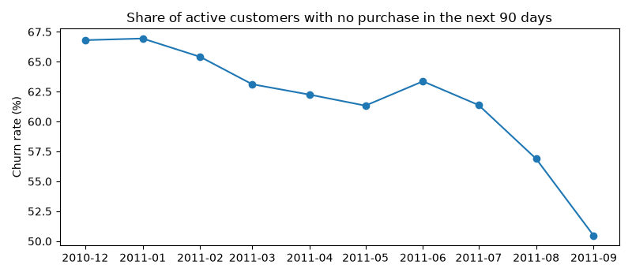
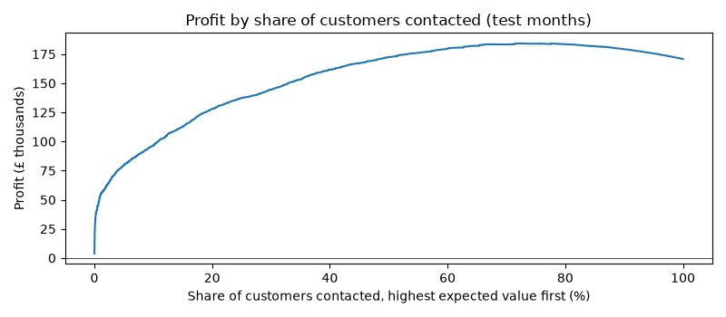

# Customer Churn Prediction & Profit Analysis

Python, pandas, scikit-learn, statistical inference

Can an online shop predict which customers are about to stop buying, and who is worth sending a "please come back" offer? This project answers that with two years of sales from a UK online gift shop (UCI Online Retail II, December 2009 to November 2011).

## Results

- Flagged at-risk customers with 86% precision on unseen months, against 78% for a recency rule. Built a leakage-free churn pipeline on 1.07M transactions (42,850 customer snapshots) with time-based validation and 20 automated tests.
- Increased estimated retention profit by £12.8K per quarter (+7.5%) over contacting every customer. Built an expected-value targeting rule that beat simpler policies in all 12 cost scenarios tested.
- Showed that 21 engineered features did not significantly beat simple recency, frequency and spend measures, using customer-level bootstrap confidence intervals. Designed a randomized experiment to measure the offer's true effect.

## How it works

1. Clean 1.07M sales lines down to 776,855 by removing lines with no customer ID, duplicates, the incomplete December 2011, non-product charges and zero prices.
2. Define churn at monthly cutoff dates: a customer who bought in the past year has churned if they buy nothing in the next 90 days. Models learn from December 2010 to April 2011 and are tested on July to September 2011.
3. Build 21 features per customer from purchases before each cutoff, such as recency, order count, spend and how overdue they are.
4. Compare a recency rule and models on recency, orders and spend with gradient boosting on all features.
5. Send an offer when churn chance × success rate × margin × spend is more than the offer cost, and compare that with contacting everybody or targeting by spend alone.





## Limits

The model shows who is likely to leave, not why. The profit figures assume 20% of churners who get an offer stay. The real rate can only be measured with an experiment: send the offer to a random half of flagged customers and compare churn after 90 days.

## Run it

```bash
python3 -m venv .venv && source .venv/bin/activate
pip install -r requirements.txt
python -m src.download
pytest
```

Then run notebooks 01 to 04 in order. The code is in src/ and the tests in tests/.
