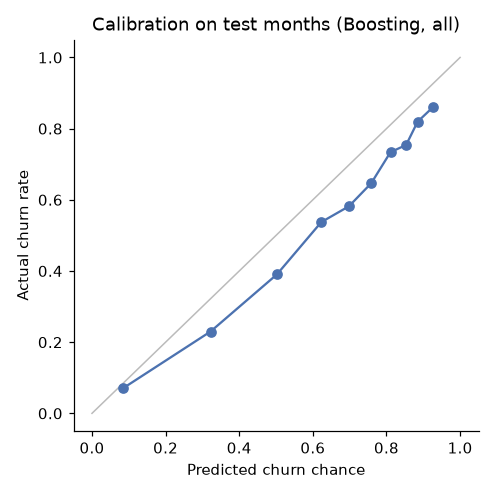
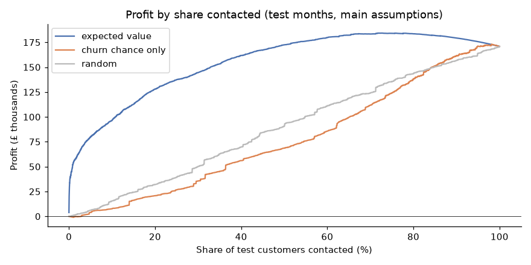

# Can an online shop predict which customers will stop buying, and is acting on it worth it?

*Customer churn project, minimum viable version. Data: UCI Online Retail II, a UK online gift
wholesaler, December 2009 to November 2011.*

## Answers in brief

1. **Do custom measures of customer behavior predict churn better than simple ones?**
   Only slightly, and not reliably. A model using 21 custom measures ranks churners a little better
   than one using recency, order count and spend alone (+0.007 PR-AUC), but the 95% interval
   includes zero and the gain does not hold across all the churn definitions fixed in advance.
   Simple behavior measures carry nearly all of the signal. Any model clearly beats a plain
   "longest since last purchase" rule.
2. **When is it most profitable to send a "please come back" offer?**
   When the expected value saved (churn chance × success rate × margin × the customer's annual
   spend) is more than the offer's cost. Under the main assumptions this means contacting about 78%
   of active customers and earns £13,000 more than contacting everybody and £3,000 more than
   targeting by spend alone over the three test months. This rule was the most profitable policy in
   all 12 cost and success-rate scenarios tested, and its advantage grows as offers get more expensive.
3. **What does the evidence show, and what does it not?**
   It shows who is likely to stop buying and that targeting by expected value beats simpler
   policies, given the assumptions. It does **not** show why customers leave, or that an offer
   would change their mind: the 20% success rate is assumed, and only a randomized experiment can
   measure it.

## Data and churn definition

About 1.07 million purchase lines were cleaned to 776,855 (removing lines with no customer ID,
duplicates, the incomplete December 2011, non-product charges and zero prices); 759,615 are
purchases and 17,240 cancellations, from 5,824 customers.

Customers never formally cancel, so churn is defined at monthly cutoff dates: a customer who bought
in the previous 365 days has churned if they buy nothing in the next 90 days (60 and 120 days as
checks). This gives 10 cutoffs (December 2010 to September 2011) and 42,850 customer snapshots.
Models learn from December 2010 to April 2011 and are judged on July to September 2011; May and
June are skipped so the two never overlap. Churn is common (65% in training months, 56% in test
months, lower in the test months because they lead into the holiday season).

## Measures

For every customer at every cutoff, 21 measures were built from purchases before the cutoff only:
recency, tenure, orders and spend over 30/90/180/365 days, spend trend, buying rhythm (usual gap
between orders, its variability, and how overdue the customer is), average order value, products
per order, return rate, autumn buying and UK location. Automated tests confirm that no purchase
after a cutoff can change any measure.

## Prediction results (test months)

| Method | PR-AUC (95% CI) | Churn rate in top 10% flagged |
|---|---|---|
| No model (everyone 65%) | 0.562 | 56% |
| Recency rule | 0.738 (0.721–0.753) | 78% |
| Logistic regression, recency/orders/spend | 0.788 (0.773–0.802) | 84% |
| Gradient boosting, recency/orders/spend | 0.787 (0.771–0.802) | 84% |
| Logistic regression, all 21 measures | 0.792 (0.777–0.807) | 86% |
| Gradient boosting, all 21 measures | 0.794 (0.779–0.808) | 86% |

Gain from the custom measures (gradient boosting, all vs raw): +0.007 PR-AUC (−0.002 to +0.016).
Robustness: +0.010 with a 60-day window (clear), +0.001 with 120 days and +0.003 for customers
active in the last 6 months (both unclear). Predictions run 7–12 points too high because churn
was lower in the test months than in training; rankings are unaffected.

## Profit results (test months)

Main assumptions: £10 per offer, 20% of churners who get an offer stay, 25% margin, value of a
saved customer = one more year of their past spend.

| Policy | Share contacted | Profit (95% CI) |
|---|---|---|
| Nobody | 0% | £0 |
| Everybody | 100% | £170,900 (£137,000–£208,300) |
| By spend only | 74% | £180,700 (£147,000–£217,800) |
| Expected value, logistic on recency/orders/spend | 80% | £177,700 (£146,000–£212,900) |
| **Expected value, gradient boosting on all measures** | **78%** | **£183,700 (£150,500–£221,500)** |

Paired differences for the best policy: +£12,800 vs everybody (£11,400–£14,300) and +£3,000 vs
spend only (£1,600–£4,200). With £50 offers, contacting everybody loses £200,000–£500,000, while
the model's rule contacts 2–24% of customers and stays profitable. The top 1% of spenders provide
18% of the profit.

## Limits

- **Prediction, not cause.** The measures show who is likely to leave, not why.
- **Assumed offer effect.** Profit levels depend on the 20% success rate, the 25% margin and
  valuing a saved customer at one year of past spend. Policy rankings held across a 10–30% success
  rate and £5–£50 offer costs, but the levels did not.
- **One retailer, two years.** Only 10 cutoffs were usable and the test months lead into the
  holiday peak, so results may differ in other seasons.
- **Identified customers only.** 23% of sales lines had no customer ID and could not be used.
- **Product mix not yet included**, pending a decision on product categories.

## Next step: an experiment

Send the offer to a random half of the customers the model flags and nothing to the other half,
then compare churn between the halves after 90 days. The difference is the real success rate,
which replaces the assumption above and turns the profit estimate into a measured result.

*Code: `src/` (cleaning, labels, measures, evaluation), 20 tests in `tests/`, notebooks 01–05.*
